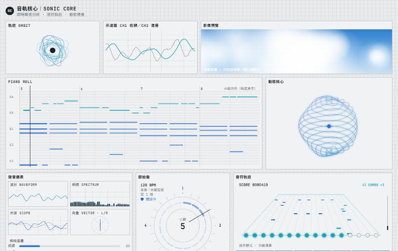
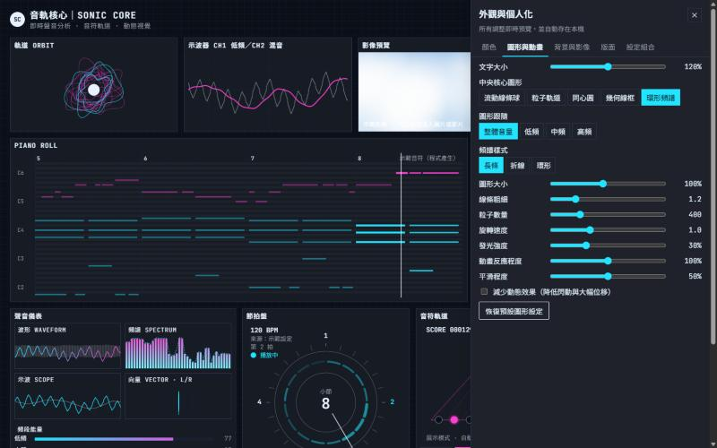
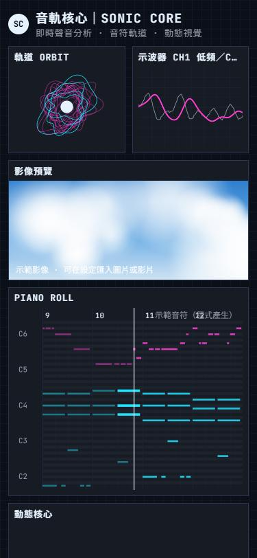
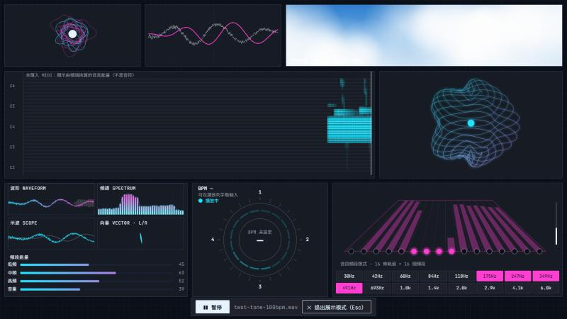

# 音軌核心｜SONIC CORE

在瀏覽器裡播放音樂、即時分析聲音，並把它畫成動態視覺的互動式音樂儀表板。灰白底、青藍線條、細格線與等寬字體，像一台精密的音樂實驗儀器；顏色、圖形與版面都可以自己調整。

**線上使用：<https://t12422485-alt.github.io/sonic-core/>**（不需安裝、不需登入，打開就能用）



| 深色霓虹主題與設定面板 | 手機版 | 展示模式（匯入音訊） |
| --- | --- | --- |
|  |  |  |

## 快速開始

1. 打開網站，按「▶ 開始示範」：播放內建示範曲。示範曲的音符由程式產生，以瀏覽器內建合成器發聲，所有圖表即時分析這段實際發出的聲音。不想出聲可以按「先不播放」，或先按播放列右側的圓形喇叭鈕靜音。
2. 在下方播放列按「匯入音訊」選擇自己的 MP3／WAV，或按「匯入 MIDI」選擇 .mid 檔。
3. 按「⚙ 外觀與個人化」調整顏色、圖形與版面。

## 已完成的功能

### 音樂播放
- 匯入本機音訊檔，可播放、暫停、重新播放、拖曳進度、調整音量與靜音；空白鍵可切換播放／暫停。
- 顯示檔名、目前時間與總長度。換歌時會先停止並釋放上一首的音訊。
- 無法解碼的檔案（格式不支援或檔案損壞）會顯示中文提示。

### 即時聲音分析
- 波形、頻譜（長條／折線／環形）、示波器（CH1 低頻、CH2 混音）、L/R 向量圖，以及低頻、中頻、高頻與音量數值。
- 所有數值都來自 Web Audio `AnalyserNode` 的即時分析，並有可調整的平滑處理。分析點在音量控制之前，所以靜音時圖表仍會反應。

### 音符軌道與 MIDI
- 匯入 MIDI 後，Piano Roll 會顯示音高格線、音符長度、音軌顏色與播放指針，並用內建合成器播放音符。Piano Roll、節拍盤與透視音遊軌道共用同一條時間軸。
- 同時匯入音訊與 MIDI 時，可以用「MIDI 偏移」調整兩者的對齊（±5 秒），並選擇是否同時播放 MIDI 合成音。程式不會自動對齊兩個檔案。
- BPM 一律標示來源：「示範設定」、「MIDI 檔」或「手動輸入」。

### 動態視覺
- 中央動態核心有五種圖形可切換：流動線條球、粒子軌道、同心圓、幾何線框、環形頻譜。可選擇跟隨整體音量、低頻、中頻或高頻。
- 上方有軌道線圈動畫、雙通道示波器與影像預覽區（可換成自己的圖片或影片）。
- 圓形節拍盤顯示拍點、小節與播放狀態。
- 底部的透視音遊軌道有 16 條，音符到達判定線時亮起，對應下方 16 個音符鍵。

### 外觀與個人化（所有調整即時預覽，不會中斷音樂）
- **顏色**：五組主題（經典灰白青藍、深色霓虹、紫色科技、暖色復古、極簡黑白）；背景、主要色、次要色、文字、框線、格線、波形、頻譜、音符、節拍盤、核心等 14 個顏色可用選色器或 HEX 色碼調整；可切換單色或漸層；文字對比過低時會提醒。
- **圖形與動畫**：文字大小、核心圖形、跟隨頻段、頻譜樣式、圖形大小、線條粗細、粒子數量、旋轉速度、發光強度、動畫反應程度、平滑程度，另有「減少動態效果」選項。
- **背景與影像**：純色或漸層背景、格線開關與透明度。可匯入本機圖片或影片作為影像預覽區內容或整體背景，並調整透明度、模糊與遮罩。影片固定靜音。
- **版面**：顯示或隱藏各模組；桌機按「▦ 編輯版面」可拖曳排序、調整寬度與高度；手機可在設定面板用上下按鈕排序；提供「完整儀表板」、「專注視覺」、「音符分析」三種預設，也可一鍵恢復預設版面。
- **設定組合**：可命名儲存多組設定（例如「夜間聽歌」），並套用、更新、重新命名或刪除。可將設定匯出為 JSON，也可從 JSON 匯入；匯入時會檢查格式與數值範圍，錯誤的欄位會改用預設值並列出原因。
- **展示模式**：全螢幕並隱藏設定與標題，模組會依螢幕高度填滿畫面，適合錄影。移動滑鼠或點擊會叫出控制列，按 Esc 退出。

## MP3 分析與 MIDI 音符的差別

- **音訊檔（MP3、WAV 等）只提供聲音波形。** 本專案會即時分析它的音量與頻率分布，但**不會**把歌曲轉成音符。只有音訊時，Piano Roll 顯示的是「由頻譜換算的音高能量」，音遊軌道則改成 16 個頻段的能量，畫面上都有標示，不是真正的音符。
- **MIDI 檔本身就記錄了每個音符**（音高、開始時間、長度），所以 Piano Roll 與音遊軌道顯示的是檔案裡真正的音符。
- 想同時看到歌曲的真實聲音與準確音符，請準備該曲的 MIDI 檔，與音訊一起匯入後用「MIDI 偏移」對齊。

## 已知限制

- 音遊軌道沒有玩家按鍵與命中判定，分數與連擊只出現在示範模式，並標示為「展示模式 · 自動演奏」。
- 不會自動偵測音訊的 BPM。只有音訊時，節拍盤需要在播放列手動輸入 BPM 才會顯示拍點。
- MIDI 用簡單的振盪器合成器播放，不是真實樂器音色；打擊樂通道（第 10 頻道）的音符也會被當成一般音高播放，聽起來不像鼓聲。
- 平板寬度（約 680～1000px）使用固定欄寬，不會套用桌機自訂的模組寬度。
- 音訊、MIDI、圖片與影片不會被保存，重新開啟網頁後需要重新選取。網頁會提示上次使用的檔名。
- 設定存在目前瀏覽器的 localStorage，換瀏覽器或清除網站資料後就會消失；需要搬移時請用 JSON 匯出、匯入。
- 目前只在 Chromium 系瀏覽器（Chrome、Edge）實測過。Firefox 與 Safari 支援所需的 Web API，但尚未實測。

## 支援的瀏覽器與檔案格式

- **瀏覽器**：近期版本的 Chrome、Edge（已實測）；Firefox、Safari（未實測）。需要支援 Web Audio API 與 ES2023。
- **音訊**：MP3、WAV 在主流瀏覽器都可以使用；OGG、M4A／AAC、FLAC 是否可用取決於瀏覽器的解碼能力。無法解碼時會顯示提示。
- **MIDI**：`.mid`、`.midi`（Standard MIDI File，格式 0 與 1）。
- **圖片**：JPG、PNG、WebP、GIF 等瀏覽器可顯示的格式。
- **影片**：MP4（H.264）、WebM 等瀏覽器可播放的格式。

## 隱私

- 你選擇的音訊、MIDI、圖片與影片都只在瀏覽器裡讀取與處理（File API、Web Audio、object URL），程式裡沒有任何上傳或傳送檔案的網路請求。
- 外觀設定、設定組合與上次播放的檔名存在本機瀏覽器的 localStorage，不會傳到任何伺服器。
- 網頁會從 Google Fonts 載入 JetBrains Mono 字型，因此瀏覽器會連線到 Google 的字型伺服器。網站本身由 GitHub Pages 託管。

## 本機安裝與開發

需要 [Node.js](https://nodejs.org/) 20.19 以上版本。

```bash
git clone https://github.com/t12422485-alt/sonic-core.git
cd sonic-core
npm ci
npm run dev
```

接著開啟終端機顯示的網址（預設是 http://localhost:5173）。要在手機上測試，可以改用 `npm run dev -- --host`，再以電腦的區網 IP 開啟。Windows 使用者也可以直接雙擊 `start.bat`。

其他指令：

| 指令 | 說明 |
| --- | --- |
| `npm run check` | TypeScript 型別檢查與 oxlint |
| `npm run build` | 建置正式版到 `dist/` |
| `npm run preview` | 在本機預覽正式版 |

本專案不需要任何環境變數或 API 金鑰。

`test-assets/` 裡有程式產生的測試素材：100 BPM 的測試音訊（WAV）、測試旋律（MIDI）、刻意損壞的 MP3，以及含錯誤數值的設定 JSON，可以用來檢查各種提示。

## 部署

推送到 `main` 分支後，GitHub Actions（`.github/workflows/deploy.yml`）會自動執行 `npm ci`、型別檢查、lint 與建置，並把 `dist/` 部署到 GitHub Pages。建置使用相對路徑（`base: './'`），所以也可以把 `dist/` 放到任何靜態網站主機。

## 程式結構

```
src/
  engine/    播放引擎（player.ts）、即時分析（signal.ts）、共用動畫迴圈（ticker.ts）、MIDI 解析、示範曲
  settings/  設定型別、主題與驗證（schema.ts）、本機儲存與設定組合（store.ts）、圖片影片素材（media.ts）
  viz/       各模組的 Canvas 繪圖
  ui/        儀表板版面、播放列、設定面板
```

## 回報問題與參與貢獻

- 發現錯誤或有功能建議，請到 [Issues](https://github.com/t12422485-alt/sonic-core/issues) 使用範本回報。
- 想修改程式，請先閱讀 [CONTRIBUTING.md](CONTRIBUTING.md)。

## 授權

- 本專案原始碼採用 [MIT License](LICENSE)。
- 使用的第三方套件與字型保留各自的授權，詳見 [THIRD_PARTY_NOTICES.md](THIRD_PARTY_NOTICES.md)。
- 示範曲、測試音訊與測試 MIDI 都由本專案程式產生，沒有使用任何受版權保護的音樂。
